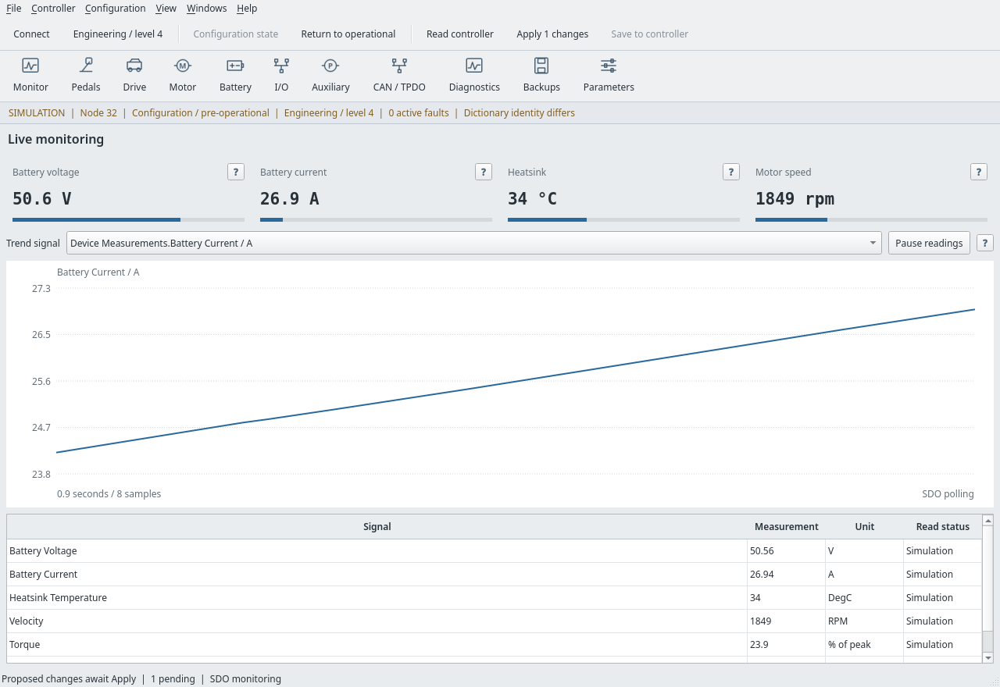
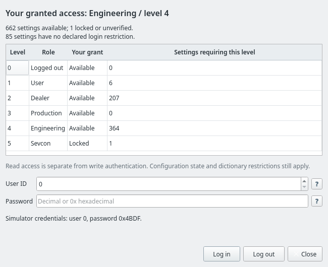
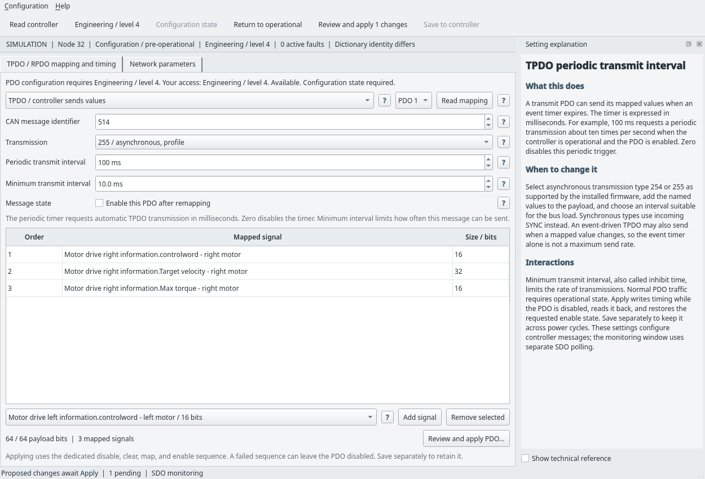

# Usage guide

A native Qt Widgets application for configuring and diagnosing Sevcon Gen4
controllers through [SevconCAN](https://github.com/bluer222/SevconCAN). It uses PySide6, native menus,
toolbars, dialogs, tables, and dockable panels. It requires no browser,
HTTP server, GTK, or remote service.

## Run

Python 3.10 or newer, PySide6, and the latest SevconCAN main branch are
required. Update both checkouts together. With the two checkouts next to each other:

    python -m pip install -e .
    python app.py

On NixOS, the repository provides the Python and Qt environment:

    nix-shell --run 'python app.py'

The native window starts with a clearly labeled simulator. Its test device
exchanges CANopen frames through SevconCAN's virtual bus. Example calibration,
maps, and animated measurements allow exploration without hardware. Simulation
does not model motor physics or persistent EEPROM.

Choose **Connect** for a physical adapter. Connecting reads identity and
status. Login and network-state changes remain explicit commands.

    python app.py --library ~/Documents/GitHub/SevconCAN --disconnected
    python app.py --eds /path/to/controller.eds

SEVCONCAN_PATH can specify the checkout. An installed sevcon_can package also
works. The launcher reports a missing dependency instead of downloading it.
To install both projects in a virtual environment:

    python -m venv .venv
    . .venv/bin/activate
    python -m pip install -e ../SevconCAN
    python -m pip install -e .
    sevcanwiz

## Workspace

- The main window monitors live signals. Toolbar icons open independent
  windows for pedals, drive, motor, battery, I/O, pump/steering, CAN, diagnostics,
  backups, and parameters. Multiple windows share one controller connection
  and pending-change set. Closing a configuration window preserves its drafts.
  Help > Search menus finds commands and windows by name or purpose.
  Ctrl+Shift+P opens menu search, Ctrl+F opens parameter search, F1 explains
  the selected setting, and F5 reads the active window.
- All 1,340 entries in the bundled EDS appear in named parameter tables.
  The target controller's installed dictionary has exactly these entries.
  Custom EDS/DCF files supply their own entries, units, scaling, limits,
  choices, and permissions. Live values come from controller reads.
- Twelve draggable curve editors have exact coordinates and keyboard
  movement. They cover throttle, footbrake, pump throttles, steering, battery
  charge, torque-speed limits, voltage/thermal cutback, and thermistor
  calibration. Proposed and current curves appear together during editing.
- Question marks explain parameters, bit fields, coordinates, connection
  options, and PDO controls. Help covers purpose, adjustment, interactions,
  accepted values, and permissions. A checkbox reveals technical references.
- The status strip and toolbar show the actual granted role and level.
  Settings show their required role and whether they are available, locked,
  read only, or require a dedicated procedure. Controls and table rows blocked
  by authentication are greyed; their question marks remain usable.
  The access dialog compares
  all six levels with the controller's current grant.
- Live meters, a selectable time plot, pause, and CSV recording display SDO
  measurements in physical units. Failed samples produce gaps. Traces retain
  180 samples; recordings stop at 50,000 samples and can be exported to CSV.
- Diagnostics show active faults, EMCY activity, controller/dictionary
  identity, a searchable 245-entry fault reference, counters, event parameters,
  and a fault-reset request. Logs and readable-value dumps export timestamps,
  exact bytes, and individual read errors.
- All five transmit and five receive PDOs have a dedicated mapping editor
  with named signals, payload size/order, identifier, transmission type,
  enable state, TPDO periodic/minimum transmit intervals, explicit review,
  and verified read-back.
- Exact-byte JSON backups support identity-checked comparison and selected
  restore through the normal pending-change workflow.
- SocketCAN, Candlelight USB, SLCAN, PCAN, and Kvaser connections have local
  interface/serial/USB discovery. Optional drivers come from SevconCAN.
- Each configuration window has its own explanation panel. Window geometry
  persists. The monitor's optional help and pending/activity docks can be
  opened through View.

## Automatic CAN transmissions

Open the **CAN / TPDO** toolbar window and its **TPDO / RPDO mapping and timing**
page. Select a TPDO, add the named values it should send, and choose an
asynchronous transmission type, 254 or 255, supported by the firmware.
**Periodic transmit interval** sets the event timer in milliseconds, such as
100 ms for approximately ten periodic transmissions per second. Zero turns
off that trigger. **Minimum transmit interval** sets inhibit time in 0.1 ms
steps and limits bursts caused by changing signals. Synchronous types 0 through
240 instead depend on incoming SYNC messages.

Enter Configuration state, Review and apply PDO, then Save to controller if
the change should persist. Return to Operational for normal PDO exchange.
The app preflights timing before any write, disables the PDO while remapping
and writing timing, verifies read-back, and restores its requested enable state.
A failure can leave the PDO disabled. The simulator verifies parameter writes;
it does not validate the controller firmware's real transmission timing.

[CAN in Automation's PDO explanation](https://www.can-cia.org/can-knowledge/pdo-protocol/)
describes mapping and event/timer/SYNC triggers.

## Apply and save

1. Read values and log in with credentials assigned to your controller.
   The simulator accepts user 0, password 0x4BDF, for Engineering level 4.
2. Explicitly enter **Configuration state** when preparing to write.
3. Edit controls or curves. Proposed changes stay in memory for the current
   connection and survive navigation. Editing performs no parameter writes.
4. Choose **Apply changes**. Review compares current/proposed values, required
   roles, and your granted access.
5. Apply checks all selected values, access, state, original bytes, and
   supported relationships before writing. Each write receives an exact-byte
   read-back check.
6. Choose **Save to controller** separately for nonvolatile storage. Save
   enforces its dictionary access requirement and configuration state.

Apply is sequential. A failure identifies the failed setting and retains
remaining drafts. Verified changes leave the pending table. Inspect or re-read
the failed setting before retrying. Applied but unsaved configuration remains
visible in the status bar. Reconnecting creates a new session and clears old
drafts. Closing with proposed changes or active recording requires a choice.

Pedal coordinates use normalized physical values displayed as percentages.
Editing stages the User defined selector. Built-in Curved and Crawl remain
selectable with a warning that the graph shows stored user points. Other maps
join stored coordinates; firmware interpolation still governs behavior.

## Physical adapters

Bring SocketCAN up at the controller's existing bitrate before connecting.
The target controller uses 500 kbit/s at node 1, not the documented
1 Mbit/s and node 32 defaults:

    sudo ip link set can0 type can bitrate 500000 restart-ms 100
    sudo ip link set can0 up

The app does not run privileged interface commands. Optional drivers:

    python -m pip install -e '../SevconCAN[slcan]'
    python -m pip install -e '../SevconCAN[gs-usb]'
    python -m pip install -e '../SevconCAN[python-can]'

See [SevconCAN adapter instructions](https://github.com/bluer222/SevconCAN/blob/main/docs/ADAPTERS.md) for drivers,
permissions, wiring, and termination. Connect accepts a firmware-specific
EDS or DCF path on this computer.

## Validation and limits

    python -m unittest discover -s tests -v

Run the complete native GUI and controller suites on NixOS:

    nix-shell --run 'QT_QPA_PLATFORM=offscreen python -m unittest discover -s tests -v'

Native tests exercise actual Qt keyboard/mouse edits, dragging, access,
independent windows, menu search, all question-mark callbacks, grey access
controls, review, Apply, Save, PDO mapping/timing, backups, selected restore,
recording, and rendering against the CANopen-frame simulator. Screenshots
are saved in docs/screenshots. Without PySide6 the native tests are skipped.

The target controller has been read through a Candlelight SocketCAN adapter:
this app's value dumps on 16 October 2026, then SevconCAN's full dictionary
scan and Engineering login and logout on 17 October. Parameter writes, PDO
remapping, and drive control remain untested on hardware.
Firmware flashing, proprietary motor identification/alignment, direct memory
writes, and generated drive demands are outside verified protocol coverage.
The PDO editor supports standard 11-bit identifiers. Instrument bar scales are display guides, not configured
controller limits. Credentials are never saved or exported.

See the [design references](design.md) and
[implementation notes](implementation.md) for source mapping and limits.

See [LICENCE](../LICENCE) for the GNU Affero General Public License v3.0.
